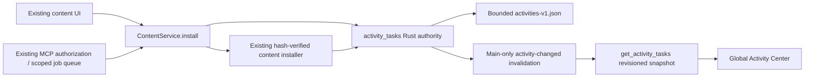

# Task/Activity Core v1 — beta.7.1

## Authority and existing infrastructure

There was no shared domain task manager. The played-session history remains in
`activity_log.rs` and Home; it is not duplicated in Activity Center. Existing MCP
jobs remain a scoped transport envelope for authorization, queueing, cancellation
before execution and idempotency. Their content-install result adds `activity_id`
referencing the single domain activity. No MCP tools/policies/permissions changed.
The existing download strip and Home character project the same Rust tasks for the
pilot. The pilot no longer creates transient legacy progress entries, so failure
cannot leave a phantom download running after Activity Center reports failure. Whole-
installation completion notifications still use the existing notification bus. Legacy
installers retain their old strip contract. Activity Center never derives completion
from that strip. Only the shared content-install service creates these
activities, so UI and MCP cannot publish conflicting activity state.

## Public contract

`commands/activity.rs::get_activity_tasks` returns `{revision,tasks,storage_warning}`.
Each task has a UUID, monotonically increasing revision, `content.install` kind,
Rust-selected `ui/mcp/system` source, content type, optional canonical instance UUID
and 8-character Modrinth project ID, status/stage enums, Unix-second timestamps,
optional `{current,total}` **bytes of the current file**, cancellability and a typed
safe error. No paths, names, arbitrary messages, request parameters or raw errors
are persisted. UI resolves a known instance UUID to its current display name locally.
Unknown/deleted instances show the content type and stable operation ID. ES/EN
messages are presentation translations of enums, not persisted provider text.

Transitions used in v1:

- `queued → running | failed | interrupted`
- `running → running | succeeded | failed | interrupted`
- terminal states reject every mutation and every cancellation request.

`cancel_requested/cancelled` are reserved wire states, **not implemented cancellation
promises**. All pilot installations are `cancellable=false`. The public cancellation
command returns `ACTIVITY_NOT_CANCELLABLE`, `ACTIVITY_ALREADY_FINISHED` or
`ACTIVITY_NOT_FOUND`; it never signals success. The UI exposes no cancellation button
for them. Future operations must implement a cooperative domain token and tested
acknowledgement transitions before setting cancellable=true. No cancel-all/force-kill.

The domain guard closes success/failure from the actual service result, and marks
unwinding/dropped/aborted futures interrupted. Missing compatible root versions now
return failure instead of reporting a successful no-op. Existing dependency/file
selection, staging/hash/rename, and per-instance mutation lock are preserved. A
failure can leave already installed dependencies; no automatic rollback is claimed.

## Concurrency, subscription and IO

In-memory mutexes cover short state edits/snapshot clones only. All heavy network,
file IO and history writes occur outside the state lock. Max 64 active tasks; new
requests above this return `ACTIVITY_CAPACITY` before changing files. Per-task
revision is taken from the same global monotonic revision. Duplicate updates are
no-ops; an update carrying a stale expected revision is rejected. Only a task's
sequential Rust guard can publish progress. Progress invalid totals are rejected;
unknown response length stays indeterminate. Updates are throttled to 250 ms per
task. Stage boundaries and terminal outcomes bypass progress throttling. A new file
or retry restarts current-file progress; there is no invented aggregate percentage.

Main-window invalidations are coalesced globally in the same 250 ms batches, before
history IO. Many simultaneous downloads therefore do not send one IPC event per
file chunk or per task. The query always returns the latest in-memory revision.

The shell owns one cleaned-up subscription; page navigation adds none. Subscribe
completes **before** initial query. Changes during a query set a dirty flag and cause
another query. Snapshot revisions suppress stale responses. A focused window
resynchronizes; failures show retained data as stale and retry at 1/2/4…30 seconds,
or immediately via the visible retry button. Healthy sessions do not poll. UI event
access does not grant operation mutation or MCP authorization.

## History and recovery

`settings/activities-v1.json` stores at most 100 terminal + 64 active typed records;
read limit 256 KiB, unknown fields rejected. An invalid file produces empty recovered
history with a storage warning; no operation is resumed. Valid active entries become
`interrupted` on restart, get new revisions and are written back. Recent terminal
entries are retained by revision; no age-based retention in v1.

A bounded wake channel and one native worker coalesce writes every 250 ms. It clones
the latest snapshot, writes a sibling `.pending` file, syncs and renames it. Writes
are serialized; no task lock is held during IO. Write failure leaves in-memory tasks
usable, raises `storage_warning`, and subsequent changes retry. Startup recovery
warning is cleared after a successful replacement history write. A hard process exit
can lose the last ~250 ms of unflushed updates; it can never turn recovered active
work into success. No destructive automatic resume is performed. Storage warnings
are advisory; current-session state remains authoritative. `.pending` is never loaded.

## Registering the next operation

Add a typed Kind/Target/Stage/Error with safe public fields; create an `Operation`
guard inside the shared domain service, choose source in the trusted Rust entry
point and close it only after the real outcome. Extend serialization/recovery,
state-transition/privacy tests and frontend translations together. Never accept
source/status/error/progress payloads directly from UI or MCP. Keep ACL main-only;
reuse existing underlying MCP permission checks. No new task mutation tools are
provided by v1. Cross-process publishers must carry expected revisions before they
are allowed to update tasks. Reserved enum states do not authorize new behavior.

## Deliberately not migrated

1. Java downloads: add measured bytes and safe staging cancellation first.
2. World backup creation: report bounded archive stages; retain existing locks.
3. Content bulk updates/rollback/export and modpacks: transactional boundaries before
   cancellation; retain existing old progress events during incremental migration.
4. Launch/runtime preparation and server installation: distinguish preparation from
   the lifetime of Minecraft; do not persist arguments or environment.
5. Updater: separate verification/download/install states without changing channel,
   signing or restart semantics.

Snapshots, MCP Transactions v2, diagnostics and Update Planner can reference IDs and
revisions later. None is implemented by this task. No dependency/framework changes,
new HTTP listener, capability file changes or broad Settings redesign were needed.
