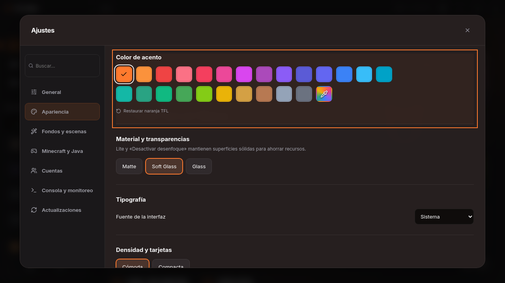
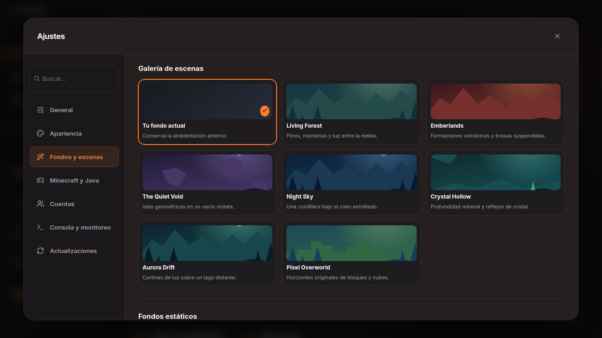
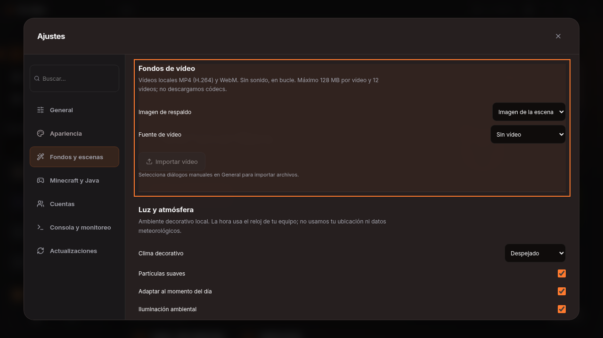
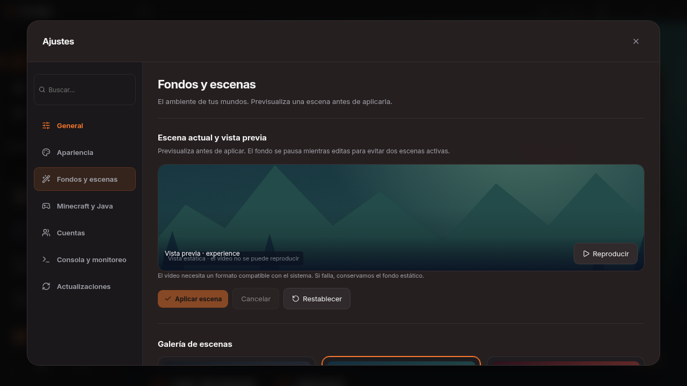
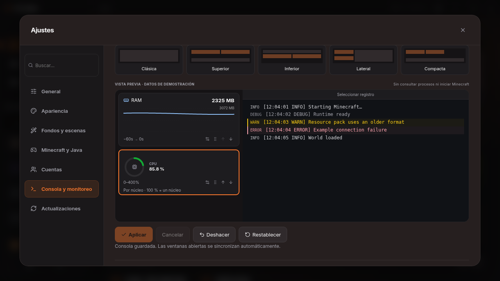
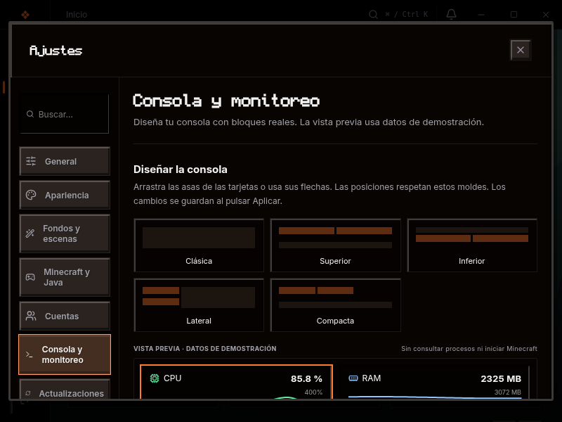
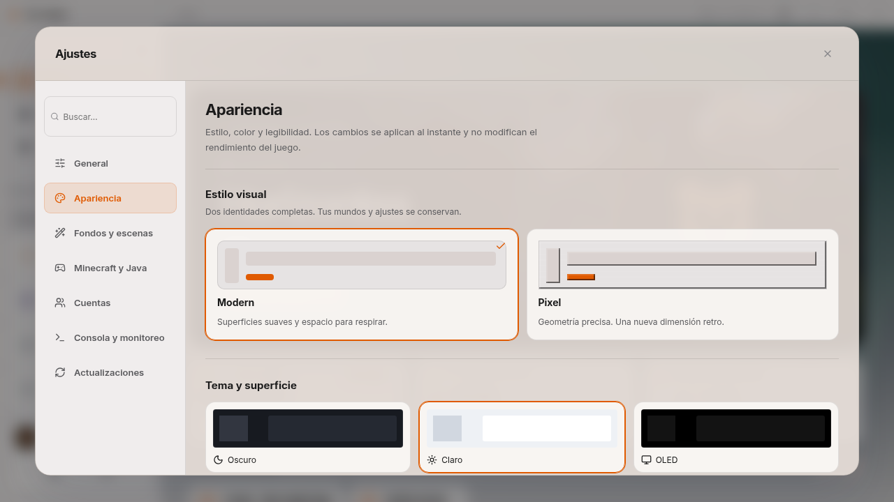
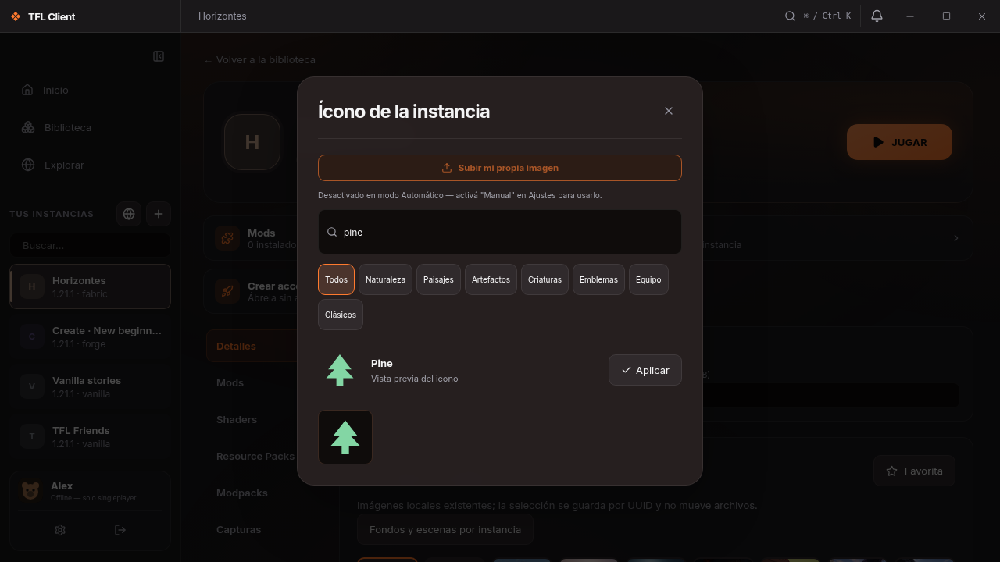
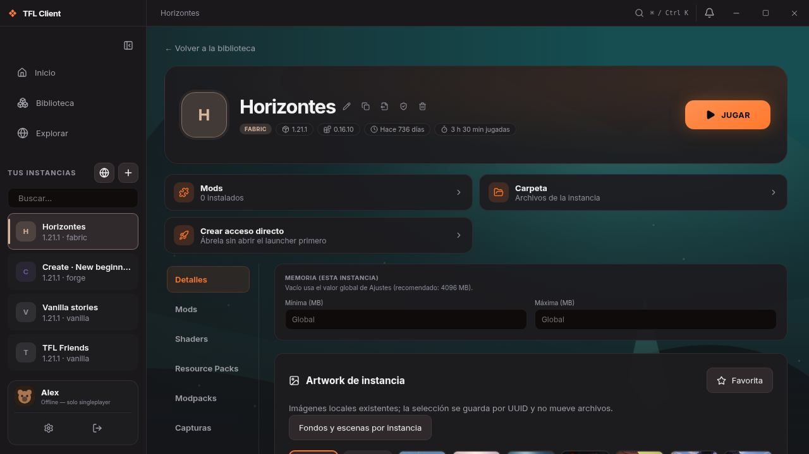

# Muestras de revisión visual

Capturas del build de producción con IPC simulado; muestran datos de prueba. La matriz completa y sus limitaciones están en [TESTING.md](TESTING.md). Los escenarios completos se conservan como artefacto de CI.

## Búsqueda y acento

El resultado abre y destaca el grupo real. Presets y color personalizado comparten la misma paleta.

## Escenas originales

Galería de composiciones locales, con miniaturas estáticas.

## Vídeo y respaldo

Importación administrada y fuente seleccionable, con imagen de respaldo.

## Diseñador de consola

Mismos bloques y renderer que la consola real; esta vista utiliza únicamente datos de demostración.

## Pixel, OLED y Lite a 800×600

Un solo marco de búsqueda y superficie opaca sin blur. La página se desplaza verticalmente.

## Apariencia clara e iconos

## Escena propia de una instancia

El detalle conserva sus ajustes de juego y cambia solo su entorno visual.

